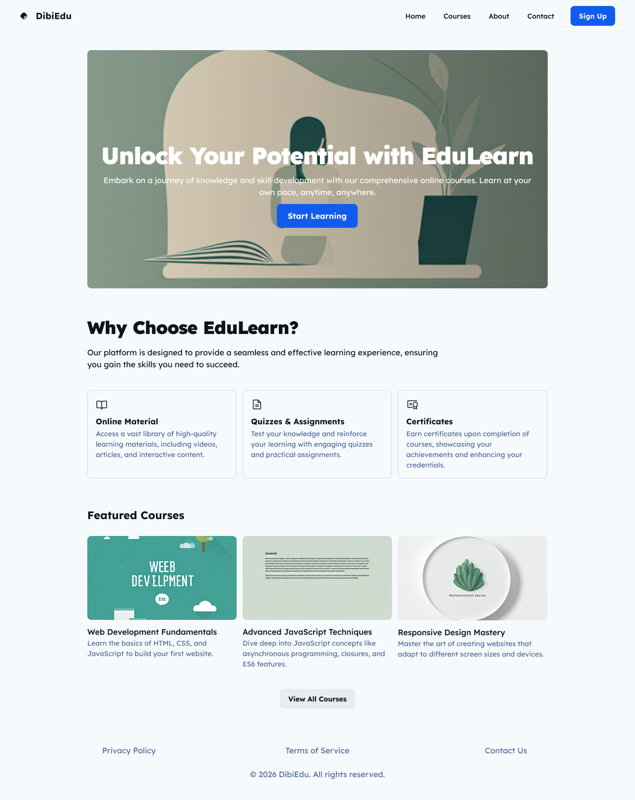
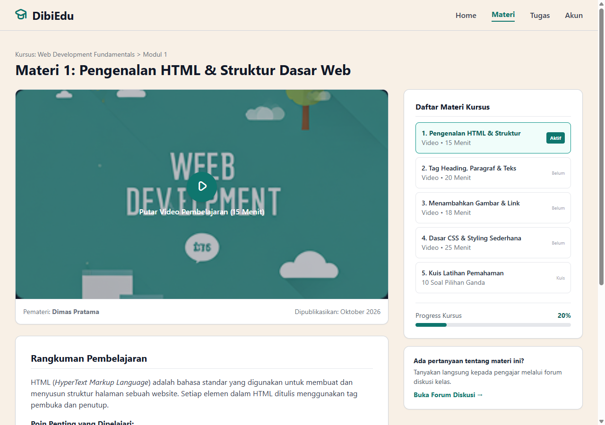
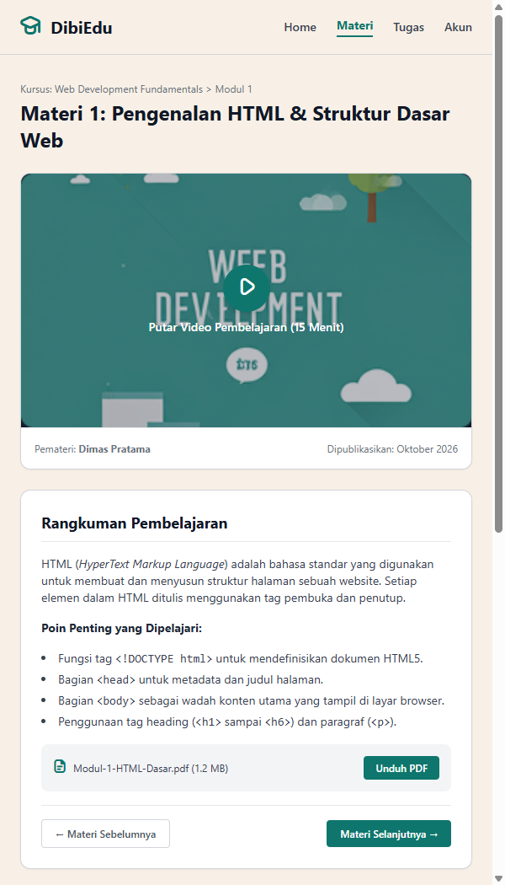

# DibiEdu - Learning Management System (LMS)
**Mini Project 2 - Frontend Web Development (FWD)**

Proyek ini merupakan pengembangan antarmuka platform *Learning Management System* (LMS) bernama **DibiEdu**, yang terdiri dari halaman beranda (*Landing Page*) dan halaman pembelajaran (*Page Materi*) yang responsif.

---

## 📌 Deskripsi Halaman

### 1. `Assignment1.html` (Landing Page)
Halaman pengenalan platform DibiEdu yang dibangun dengan HTML & CSS Native.
* **Hero Section**: Slogan edukasi dengan tombol aksi *Start Learning*.
* **Fasilitas Pembelajaran**: Online Material, Quizzes & Assignments, dan Certificates.
* **Featured Courses**: Kursus unggulan (*Web Development Fundamentals*, *Advanced JavaScript Techniques*, *Responsive Design Mastery*).

### 2. `assignment2.html` (Page Materi LMS)
Halaman penjabaran materi kursus yang dibangun menggunakan **HTML & Tailwind CSS**.
* **Area Pembelajaran**: Pemutar video materi interaktif, pemateri, dan tanggal publikasi.
* **Rangkuman Materi**: Ringkasan poin-poin penting pembelajaran dan fitur unduh modul PDF.
* **Daftar Materi (Silabus)**: Navigasi materi per modul lengkap dengan status materi aktif dan bar progres kursus (20%).
* **Fitur Responsif**:
  * **Layar Hape (600px)**: Tata letak otomatis menjadi satu kolom (*stacked vertical*), teks dan tombol adaptif (*touch-friendly*).
  * **Layar Dekstop (1280px)**: Tata letak dua kolom proporsional (`max-w-[1280px]`) dengan jarak yang lapang dan nyaman dibaca.

---

## 📷 Screenshot Tampilan

### 1. Landing Page (`Assignment1.html`)

---

### 2. Page Materi - Desktop 1280px (`assignment2.html`)

---

### 3. Page Materi - Mobile 600px (`assignment2.html`)

---

## 🛠️ Teknologi yang Digunakan
* **HTML5** (Semantik)
* **Tailwind CSS** (v3 via CDN)
* **CSS3 Native** (untuk Assignment 1)
* **Flaticon Uicons** (Ikonografi)

